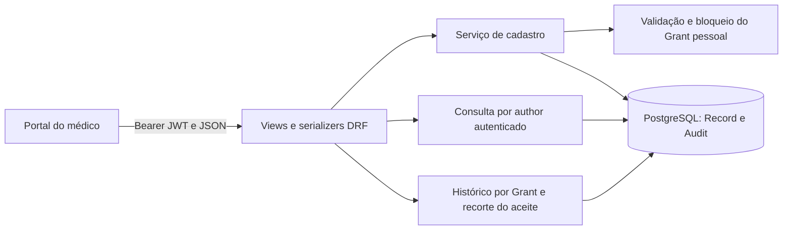

# MarIA — continuidade do atendimento por profissional

15/10/2026 • primeira entrega funcional da mudança de direção.

## Decisão de produto

O médico possui identidade única no HUB e acompanha pacientes independentemente dos locais em que atende. O paciente autoriza o profissional identificado, com finalidade, prazo e possibilidade de revogação. A clínica permanece como contexto organizacional e origem dos registros recebidos por integração. Não existe schema nem banco separado por médico.

O frontend existente é a base visual do produto: os estilos de login e pacientes, imagens e menu lateral são reutilizados nas novas telas integradas. As telas antigas com localStorage permanecem como referência durante a adaptação gradual; não são fonte de dados para o portal integrado.

## Implementação

- `DoctorProfile`: identidade profissional habilitada pela administração, independente de `Membership`. Ter uma conta comum não habilita acesso profissional. O protótipo não verifica registro profissional real.
- `Grant.audience`: `doctor` para autorização pessoal; `clinic` para permissões organizacionais anteriores. Em `doctor`, `requester` é o destinatário e `clinic` é nula. Uma restrição do banco exige essa consistência.
- A migration 0003 mantém todas as autorizações existentes como `clinic`, sem alterar o texto nem o alcance do consentimento anterior. Cria perfis para usuários que já possuem vínculo médico ativo. Não substitui senhas ou chaves.
- A carteira lista pacientes para os quais o médico já solicitou autorização ou possui registros de sua autoria. A lista é acompanhamento, não autorização de leitura compartilhada. Solicitar acesso exige o UUID compartilhado pelo paciente; não existe pesquisa pública de pacientes.
- A consulta pessoal exige perfil profissional ativo e autorização pessoal aprovada, vigente e não revogada. Não exige vínculo com a clínica de origem ou `PatientLink` naquela clínica.
- O escopo continua `prior_records`: somente registros ocorridos e recebidos até o aceite. Novos registros exigem nova autorização. Uma outra autorização pessoal ainda válida pode sustentar acesso após revogação de uma delas.
- Autorizações pessoais não se transferem a colegas nem habilitam consultas pelas rotas organizacionais. Autorizações organizacionais antigas não habilitam a rota pessoal.
- Origem clínica, autor, datas e identificadores dos registros são preservados. Consultas pessoais permitidas e negadas geram auditoria.

## Contrato HTTP

Todas as APIs abaixo exigem Bearer JWT já emitido pelo login existente.

| Método e rota | Função |
| --- | --- |
| `GET /api/v1/me/` | Inclui `is_doctor`, identidade do paciente e vínculos |
| `GET /api/v1/doctor/patients/` | Carteira do profissional autenticado |
| `GET /api/v1/doctor/grants/` | Solicitações pessoais feitas pelo profissional |
| `POST /api/v1/doctor/grants/` | Solicita acesso com `patient_id`, `purpose`, `expires_at` |
| `GET /api/v1/doctor/patients/{id}/history/` | Histórico pessoal autorizado; 403 sem permissão vigente |
| `POST /api/v1/doctor/patients/{id}/records/` | Cadastra atendimento direto com autorização pessoal vigente |
| `GET /api/v1/doctor/patients/{id}/records/` | Somente registros de autoria do médico autenticado, mesmo após revogação ou expiração |
| `GET /api/v1/patient/grants/` | Solicitações dirigidas ao paciente, com destinatário explícito |
| `POST /api/v1/patient/grants/{id}/decision/` | Aceita, recusa ou revoga; aceite exige `term_version` apresentada |

As rotas anteriores de clínicas e de ingestão permanecem disponíveis para compatibilidade e demonstração técnica. A chave de integração identifica o sistema que envia registros; não é necessária para solicitar ou consultar acesso pessoal.

## Frontend integrado

Abra `/hub/login/` pelo servidor Django. `frontend/hub-login.html` reutiliza o login visual anterior; `frontend/hub.html` reutiliza estilos e estrutura da tela de pacientes. `hub-api.js` centraliza requisições e tratamento de sessão; `hub.js` renderiza dados da API usando `textContent`.

O token de acesso fica em `sessionStorage`, por aba. Não se guarda refresh token nem senha; o vencimento exige novo login. Esse armazenamento continua acessível a JavaScript e precisa ser reavaliado junto à autenticação de produção. As chaves e configurações JWT não foram alteradas nesta entrega.

As telas são templates Django: não devem ser abertas diretamente pelo Live Server nem publicadas isoladamente no Nginx/Vercel. Esses serviços ainda representam somente a interface legada. O portal funcional deve ser servido pelo Django, na mesma origem da API.

## Roteiro de validação manual

1. Aplicar `python backend/manage.py migrate` usando o ambiente virtual e iniciar o Django.
2. Entrar como `paciente_demo` em `/hub/login/`, copiar o identificador MarIA exibido no perfil e sair.
3. Entrar como `medico_b`, preencher identificador, finalidade e prazo futuro, e enviar solicitação.
4. A carteira já mostrará o acompanhamento, mas a consulta ao histórico será negada enquanto não houver aceite.
5. Entrar como paciente, atualizar solicitações, ler o termo que identifica o profissional e autorizar.
6. Entrar como `medico_b`, atualizar acompanhamento e consultar. Registros anteriores da Clínica A também podem aparecer, mantendo a procedência.
7. Revogar pelo paciente; uma nova consulta do médico deve ser negada se não existir outra autorização pessoal válida.

Use as senhas locais já configuradas. Não é necessário reexecutar `seed_demo`: isso substitui credenciais. Os registros existentes são aproveitados; o envio técnico continua em `/demo/`.

## Limites desta entrega

Não implementados: upload de exames, cadastro público, verificação real de identidade profissional/paciente, encaminhamento dedicado entre médicos, correção de atendimentos, migração de todas as telas antigas e publicação. O portal cobre solicitação, decisão, leitura do histórico pessoal e cadastro direto de atendimentos. O compartilhamento com outro médico ocorre mediante nova solicitação própria, nunca por transferência automática.

Os testes automatizados cobrem o fluxo pessoal sem vínculo de clínica, isolamento entre profissionais, manutenção das permissões antigas, perfil inativo, prazo, revogação, escopo temporal, titularidade da decisão, versão do termo, restrições do banco e renderização das páginas. Os testes são complementados pelos testes anteriores do HUB.

## Validação realizada em 15/10/2026

Migration 0003 aplicada no PostgreSQL local. Os 27 testes passaram no PostgreSQL e na validação auxiliar SQLite. `manage.py check` não apontou problemas e `makemigrations --check --dry-run` não identificou alterações pendentes. A configuração atual da chave JWT ainda gera aviso de comprimento: sua revisão permanece adiada conforme combinado.

## Evolução: atendimentos diretos — 15/10/2026

A migration 0004 permite registros sem integração e acrescenta clínica de contexto opcional. Os registros anteriores continuam vinculados à integração original. A restrição `record_source_context` impede misturar integração com clínica direta e exige identificador externo somente para registros integrados. Sem integração, `external_id` fica vazio.

O cadastro requer perfil profissional ativo e pelo menos uma autorização pessoal vigente do paciente. A clínica é opcional; quando informada, exige vínculo médico ativo nela. Não exige chave de integração nem vínculo local do paciente. A autoria vem exclusivamente da autenticação; o cliente não escolhe o autor. Data futura e descrição vazia são recusadas. A criação e sua auditoria são gravadas na mesma transação, com bloqueio das autorizações em ordem estável para coordenar revogação. Tentativas sem autorização também ficam auditadas.

`GET records/` filtra estritamente por `author` e retorna `external_access: false`. Inclui tanto atendimentos diretos quanto registros integrados do mesmo autor. Exige perfil ativo; retorna 404 se não houver registros do próprio autor para o paciente. A autorização compartilhada não é necessária nessa consulta. Isso é uma regra funcional do protótipo, não uma definição de prazo de retenção para produção.

`GET history/` continua exigindo autorização vigente e respeitando o recorte temporal do aceite. Um registro recém-criado não entra automaticamente em autorizações anteriores de outros profissionais. A revogação bloqueia novas leituras compartilhadas e novos cadastros quando não houver outra autorização pessoal vigente; não apaga os registros.

### Entrada e saída

POST em `/api/v1/doctor/patients/{id}/records/`, autenticado pelo Bearer JWT existente:

```json
{
  "occurred_at": "2026-10-15T10:00:00-03:00",
  "summary": "Atendimento fictício para demonstração acadêmica.",
  "clinic_id": null
}
```

Resposta 201 com `id`, `patient_id`, `author_id`, `author_name`, `clinic_id`, `clinic_name`, `occurred_at`, `summary` e `received_at`. Em atendimento independente, os dois campos de clínica são nulos. GET retorna `{records: [...], limit: 100, external_access: false}`. Dados inválidos retornam 400, ausência de autorização/perfil/vínculo retorna 403 e paciente inexistente retorna 404; requisição sem autenticação retorna 401.

O frontend envia o formulário via `hub-api.js`, trata erros dentro do diálogo, desabilita o envio durante a requisição e consulta os próprios registros após salvar. “Registrar atendimento” fica indisponível quando a autorização carregada não está vigente; o backend sempre verifica novamente. Após decisão do paciente em outra aba, use “Atualizar acompanhamento”. Não há repetição automática do POST nem chave de idempotência nesta rota: em caso de falha de comunicação, consulte “Meus atendimentos” antes de repetir o cadastro.

### Arquitetura do fluxo



Tecnologias mantidas: HTML/CSS/JavaScript com módulos, templates Django, Django REST Framework, autenticação JWT já existente, ORM Django e PostgreSQL. Não há dependência nova. Migração 0004 aplicada localmente, preservando dados e credenciais. A suíte completa passou com 31 testes no PostgreSQL, incluindo criação, isolamento por autoria, contexto clínico, expiração, revogação e restrição de origem.

Validação manual: cadastro de um registro fictício independente por `medico_a`, consulta imediata, revogação pelo paciente e nova consulta em “Meus atendimentos” com sucesso. O registro de teste permanece identificado como validação, e a autorização criada para esse teste terminou revogada. Testes automatizados também confirmam 403 no histórico compartilhado e em novos cadastros após revogação. O relatório da rodada anterior permanece como evidência histórica.

Para reproduzir: autorize o médico pelo paciente, atualize a carteira, clique “Registrar atendimento”, preencha os campos e salve. Consulte “Meus atendimentos”; revogue pelo paciente e consulte novamente. “Consultar histórico” deve ser negado sem outra autorização pessoal vigente. Edição, exclusão e anexos não fazem parte deste incremento.

Histórico da Fase 02: incremento de cadastro de atendimentos e consulta por autoria concluído em 15/10/2026. Planejamento técnico: fluxo principal implementado e validado; próxima etapa é consolidar a documentação acadêmica e os diagramas gerais na direção por profissional. O PDF anterior de arquitetura continua histórico e ainda precisa ser refeito antes da entrega.


### Ajuste de navegação e prazos — 15/10/2026

O portal separa as visualizações por navegação: `#patients` apresenta carteira, situação de acesso e atendimentos; `#requests` apresenta pedidos, finalidade, datas e termos. Uma nova solicitação por paciente preenche identificador e finalidade, mas exige novo aceite e não altera autorizações anteriores.

O POST `/api/v1/doctor/grants/` recebe `patient_id`, `purpose` e `duration_days` (10, 30, 60 ou 90). O servidor calcula `expires_at` a partir do envio. A aprovação não reinicia o prazo. O termo e a resposta mantêm a data final explícita. O contrato legado de clínicas e as autorizações existentes permanecem válidos.


### Histórico pessoal e documentos — 15/10/2026

- Paciente: aba `#my-history`, consulta todo o próprio histórico e adiciona informações/exames com autoria identificada como relato do paciente. Não depende de autorização médica.
- GET/POST `/api/v1/patient/records/`: o paciente é sempre derivado da conta autenticada; POST aceita JSON ou multipart (`occurred_at`, `summary`, `attachment` opcional).
- POST `/api/v1/doctor/patients/{id}/records/`: passa a aceitar o mesmo anexo opcional por multipart; mantém autorização pessoal vigente e contexto de clínica opcional.
- Cada registro aceita um PDF, JPG ou PNG de até 10 MB. Extensão e assinatura inicial são verificadas, sem varredura antivírus ou validação integral do documento. Arquivos são entregues como download, com `nosniff` e `no-store`.
- GET `/api/v1/attachments/{id}/download/`: JWT obrigatório. Acesso pelo próprio paciente, pelo médico autor habilitado ou por médico com autorização pessoal vigente que inclua o registro. Documentos novos não ampliam retroativamente o aceite anterior. Não há URL pública de mídia.
- `RecordOutput` inclui `patient_reported` e `attachments` (id, nome, tipo, tamanho), sem bytes do documento. As listagens não carregam o conteúdo binário dos anexos.
- Migração `0005_attachment`: tabela de anexos, limite de tamanho e vínculo único com registro. No protótipo, o conteúdo fica no PostgreSQL, garantindo gravação atômica junto ao registro e inclusão no backup do banco. Para volume maior, planejar armazenamento privado de objetos e política de retenção; não foi implementada criptografia específica dos arquivos.
- Captura móvel: input de câmera traseira quando suportado pelo aparelho/navegador. Não é scanner com recorte, correção de perspectiva ou OCR; validação física em celular permanece pendente.
- Auditoria de criação, consulta do histórico pessoal e download; histórico não oferece alteração/exclusão de registros nesta etapa.
- Verificação: 37 testes aprovados no PostgreSQL, incluindo isolamento entre pacientes, anexos privados, revogação, corte temporal do aceite, autoria, formato e tamanho.


### Restrição de documentos na visão médica — 15/10/2026

Esta alteração substitui a política de download descrita na etapa anterior: o GET `/api/v1/attachments/{id}/download/` aceita somente o próprio paciente. Médicos, inclusive autores do registro, recebem HTTP 403 ao tentar obter o original por essa rota.

O médico usa o visualizador do hub: GET `attachments/{id}/preview/` retorna nome e número de páginas; GET `attachments/{id}/pages/{n}/` gera uma imagem PNG com identificação do usuário e horário. PDFs são rasterizados no servidor (até 100 páginas, lado máximo 1800 pixels), sem entregar o PDF original, links, scripts ou toolbar nativa de PDF. Imagens também são recodificadas em PNG. Bibliotecas: pypdfium2 e Pillow, fixadas em requirements.lock.txt.

A autorização é conferida e auditada em cada consulta/página. O visualizador revalida o acesso a cada 30 segundos e limpa a imagem ao receber uma negativa ou ao fechar a janela. O médico autor habilitado mantém acesso aos próprios registros, conforme a política existente; esse vínculo não libera download do original. Cache privado desabilitado nas respostas de conteúdo.

Limite técnico: páginas exibidas são recebidas pelo navegador e podem ser capturadas, fotografadas ou copiadas por outros meios. Marca de identificação, ocultação de impressão e ausência de download no hub reduzem facilidades de cópia, mas não são DRM nem garantia de impossibilidade de reprodução. A verificação periódica não remove cópias já capturadas nem revoga instantaneamente uma página já entregue.

Verificação: 39 testes aprovados, incluindo proibição do original para médicos, visualização rasterizada, páginas inválidas, arquivo corrompido, isolamento e corte temporal/revogação.


### Perfis pessoais e profissionais — 17/10/2026

Nova aba `#profile` no portal para médico e paciente. GET/PATCH `/api/v1/me/profile/` consulta e altera somente a própria conta autenticada. Nome completo, e-mail de contato e telefone são editáveis. O usuário de login, papéis, identificadores e habilitação profissional não são editáveis nesse contrato.

O paciente edita a data de nascimento e consulta seu identificador MarIA. O nome é sincronizado entre Patient e User. O médico informa especialidade e CRM/UF (campos opcionais, CRM e UF preenchidos em conjunto). O registro profissional é declarado e não verificado; não libera acesso ou habilita automaticamente o profissional. Nome e contato não alteram os termos de autorizações já registrados.

Migração 0006: AccountProfile para telefone, campos de especialidade e registro em DoctorProfile. Não executa seed nem recria dados. Atualizações são transacionais, serializadas por conta e registradas em auditoria sem copiar valores pessoais para o evento.

Verificação: 45 testes aprovados no PostgreSQL, cobrindo dados próprios, isolamento entre usuários, campos inválidos e tentativas de alterar papéis/identificadores. Conferência visual bloqueada pela política de acesso do navegador integrado nesta sessão.

Inicialização local: PostgreSQL Docker e Django em 127.0.0.1:8000. Corrigida somente POSTGRES_PORT no .env para 5433, devido ao conflito da porta 5432; senhas e chaves não foram alteradas.
